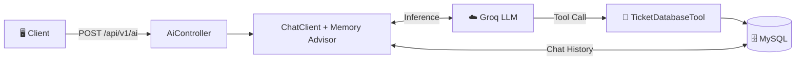

<div align="center">

# 🎧 Help Desk System

### AI-Powered Customer Support & Ticketing Backend

*An autonomous AI assistant that doesn't just chat — it actually creates, tracks, and updates support tickets in a real database.*

[](https://www.oracle.com/java/)
[](https://spring.io/projects/spring-boot)
[](https://spring.io/projects/spring-ai)
[](https://www.mysql.com/)

</div>

---

## 💡 What Is This?

Most AI chatbots just **talk**. This one **acts**.

Meet **Liza** — an AI help desk assistant built with Spring AI's **Tool Calling** feature. When a user reports an issue, Liza doesn't just respond with a canned message. She:

1. 🔍 **Checks** the database for existing tickets using the user's email
2. 🎫 **Creates** a real ticket in MySQL with auto-generated ID, priority, and status
3. ✏️ **Updates** existing tickets when users provide additional details
4. 🧠 **Remembers** the entire conversation across sessions (persistent JDBC memory)

> **The key difference?** Every ticket ID Liza mentions is **real** — pulled from the database, not hallucinated.

---

## 🏗 Architecture



---

## ✨ Features

<table>
<tr>
<td width="50%">

### 🤖 Autonomous Agent
Liza collects issue details step-by-step, asks clarifying questions, determines priority, and only creates a ticket when she has everything she needs.

### 🛠️ Real Tool Execution
The LLM doesn't fake it — it invokes actual Java methods annotated with `@Tool` that execute database queries via JPA.

### 🧠 Persistent Memory
Conversations survive server restarts. Backed by MySQL via `JdbcChatMemoryRepository` with a sliding window of 15 messages.

</td>
<td width="50%">

### ⚡ Streaming Responses
Real-time Server-Sent Events (SSE) for a live typing experience on the frontend via `Flux<String>`.

### 🛡️ Zero Hallucinated IDs
Ticket IDs come from MySQL's `AUTO_INCREMENT`, not the LLM's imagination. The system prompt strictly enforces tool usage.

### 🌐 Frontend-Ready
CORS enabled, `POST`-based API, optional `ConversationId` header with safe defaults — plug any frontend right in.

</td>
</tr>
</table>

---

## 🔧 Tools the LLM Can Call

| Tool | What It Does |
|:---|:---|
| `createTicketTool` | Saves a new ticket (summary, description, category, priority, email) to MySQL |
| `getTicketsByEmail` | Looks up all existing tickets for a user — prevents duplicates |
| `updateTicket` | Appends notes, changes status/priority on an existing ticket |
| `getCurrentTime` | Returns current system timestamp when the LLM needs it |

Each tool accepts a lightweight **Java `record`** (not the raw JPA entity) to avoid deserialization crashes with dates and enums.

---

## 🚀 Quick Start

### Prerequisites

- **JDK 25+**
- **MySQL 8.0+** running on `localhost:3306`
- A **Groq API Key** (free at [console.groq.com](https://console.groq.com))

### 1. Clone & Navigate

```bash
git clone https://github.com/Sagar-devx/help-desk-system.git
cd help-desk-system/help-desk-backend
```

### 2. Set Your API Key

```bash
# PowerShell
$env:OPENAI_API_KEY="gsk_your_groq_api_key_here"

# Bash / Zsh
export OPENAI_API_KEY="gsk_your_groq_api_key_here"
```

### 3. Run

```bash
# Windows
.\mvnw.cmd spring-boot:run

# macOS / Linux
./mvnw spring-boot:run
```

> App starts on **`http://localhost:8081`**. MySQL database & tables are auto-created.

---

## 📡 API Endpoints

### Chat (Synchronous)

```bash
curl -X POST http://localhost:8081/api/v1/ai \
  -H "Content-Type: text/plain" \
  -H "ConversationId: session-001" \
  -d "My laptop keeps crashing. Email: sagar@test.com"
```

### Chat (Streaming / SSE)

```bash
curl -X POST http://localhost:8081/api/v1/ai/stream \
  -H "Content-Type: text/plain" \
  -H "Accept: text/event-stream" \
  -H "ConversationId: session-001" \
  -d "Do I have any open tickets? My email is sagar@test.com"
```

| Endpoint | Method | Content-Type | Description |
|:---|:---|:---|:---|
| `/api/v1/ai` | `POST` | `text/plain` | Full response after tool execution |
| `/api/v1/ai/stream` | `POST` | `text/event-stream` | Token-by-token live streaming |

> `ConversationId` header is optional — defaults to `"default"`.

---

## 🗄 Database

Two tables, both auto-managed:

**`help_desk_tickets`** — User support tickets

| Column | Type | Notes |
|:---|:---|:---|
| `id` | `BIGINT` | Auto-increment PK |
| `summary` | `LONGTEXT` | AI-generated issue title |
| `description` | `TEXT` | Detailed issue + appended updates |
| `category` | `VARCHAR` | Hardware / Software / Technical / Account |
| `email` | `VARCHAR` | User's contact email |
| `priority` | `ENUM` | `LOW` · `MEDIUM` · `HIGH` · `URGENT` |
| `status` | `ENUM` | `OPEN` · `CLOSED` · `RESOLVED` |
| `created_on` | `DATETIME` | Set automatically on insert |
| `updated_on` | `DATETIME` | Set automatically on update |

**`spring_ai_chat_memory`** — Persistent conversation history *(auto-created by Spring AI)*

---

## 📂 Project Structure

```
help-desk-system/
├── README.md
└── help-desk-backend/
    ├── pom.xml
    └── src/main/
        ├── java/com/helpdesk/
        │   ├── config/         → AiConfig (ChatClient + Memory)
        │   ├── controller/     → AiController (REST + SSE)
        │   ├── entity/         → Ticket, Priority, Status
        │   ├── repository/     → TicketRepository (JPA)
        │   ├── service/        → AiService, TicketService
        │   └── tools/          → TicketDatabaseTool (@Tool + Records)
        └── resources/
            ├── application.yaml
            └── helpdesk-system.st  → AI persona & behavior rules
```

---

## 🔄 How It Works (End to End)

```
User: "My Wi-Fi keeps dropping. Email: john@test.com"
                    │
                    ▼
        ┌───────────────────────┐
        │   System Prompt       │  ← helpdesk-system.st
        │   (Liza's persona)    │
        └──────────┬────────────┘
                   │
                   ▼
        ┌───────────────────────┐
        │  LLM decides to call  │
        │  getTicketsByEmail()  │  ← Checks for existing tickets
        └──────────┬────────────┘
                   │ No open tickets found
                   ▼
        ┌───────────────────────┐
        │  LLM calls            │
        │  createTicketTool()   │  ← Saves to MySQL
        └──────────┬────────────┘
                   │ Returns: { id: 42, status: OPEN, ... }
                   ▼
        ┌───────────────────────┐
        │  Liza responds with   │
        │  real Ticket ID: 42   │  ← No hallucination
        └───────────────────────┘
```

---

## 💻 Tech Stack

| | Technology | Version | Role |
|:---|:---|:---|:---|
| ☕ | Java | 25 | Language |
| 🍃 | Spring Boot | 4.1.2 | Application Framework |
| 🤖 | Spring AI | 2.0.1 | ChatClient, Tool Calling, Memory |
| 🗄️ | MySQL | 8.0+ | Tickets + Chat History |
| ☁️ | Groq | — | LLM Inference (Qwen) |
| ⚡ | Project Reactor | — | Reactive Streaming (Flux) |
| 🔧 | Lombok | — | Boilerplate Reduction |

---

## 👤 Author

**Sagar** · [@Sagar-devx](https://github.com/Sagar-devx)

Built with ☕ Java, 🍃 Spring, and a lot of curiosity.
